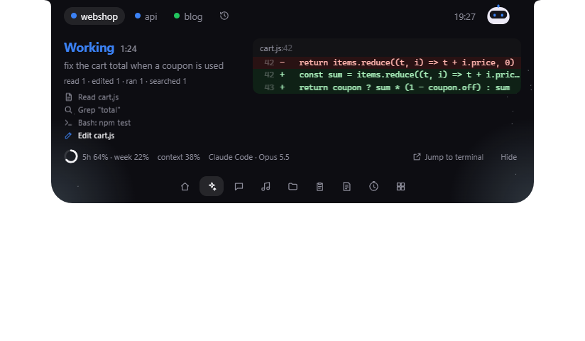
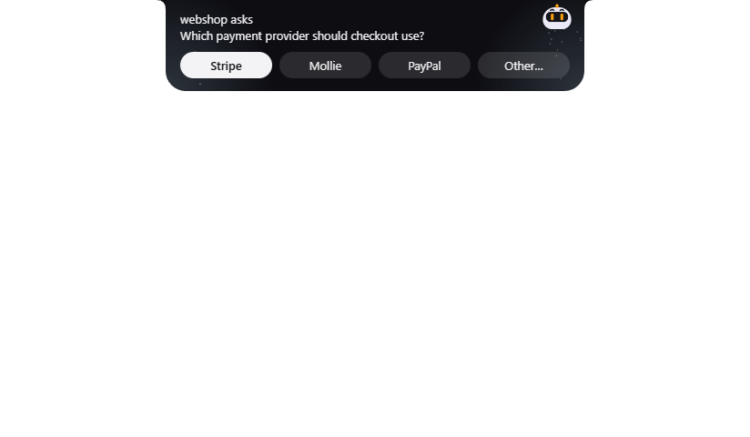
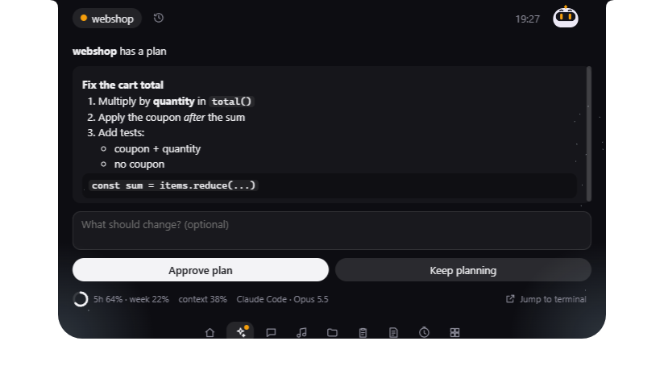
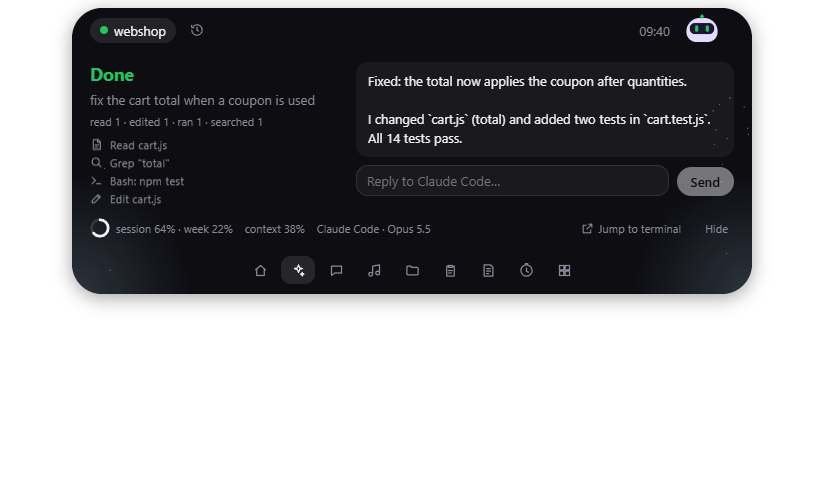
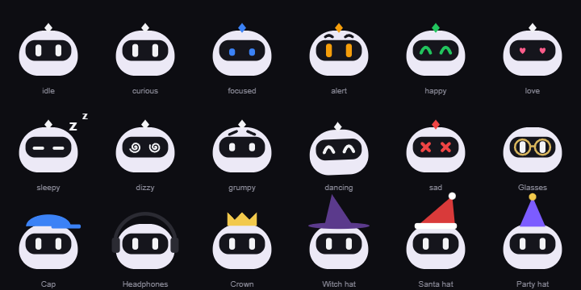
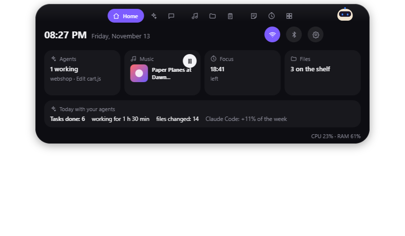
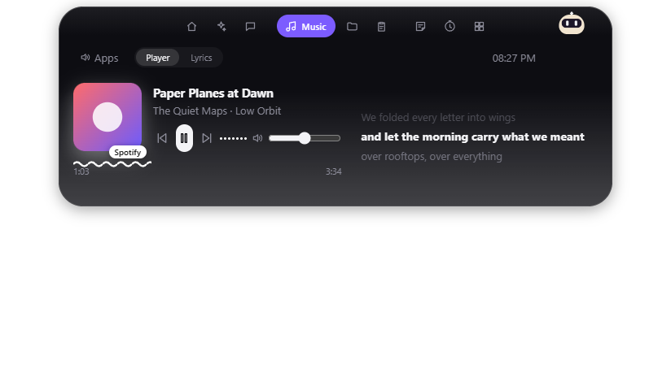
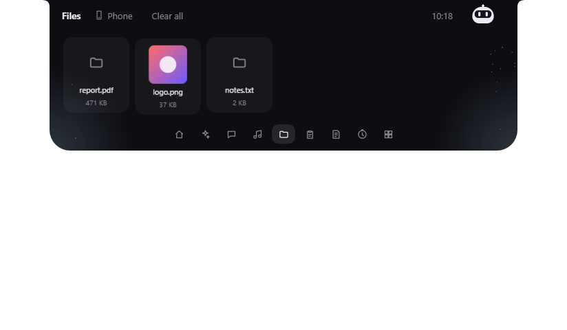
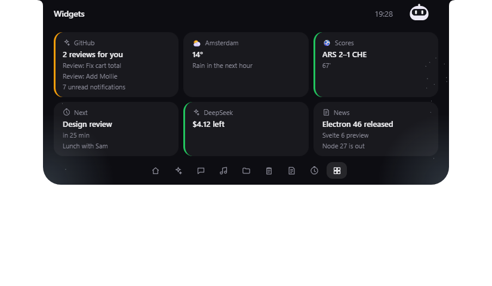

# Pebble

A notch-style island for Windows that follows your AI coding agents and answers their questions from the top of your
screen. Free and open source (MIT).

| Working | Needs you | Plan review | Done, reply |
| --- | --- | --- | --- |
|  |  |  |  |

**Install:** download `Pebble Setup <version>.exe` from
[Releases](https://github.com/YousefYGhanem/Pebble/releases) (Windows 10/11, no admin rights). It updates itself; the
installer is not signed yet, so Windows asks once (More info → Run anyway). Uninstalling takes Pebble out of every agent
and shell again. Releasing: [docs/RELEASING.md](docs/RELEASING.md).

```
npm install
npm run build:native   # native/publish (and native/out) pebble-native.exe: needs the .NET 10 SDK + Visual Studio C++ tools
npm run dev        # Electron + Vite with hot reload (main-process changes restart the app)
npm test           # vitest (on Windows also runs the real PowerShell hooks and the CLI)
npm run typecheck  # svelte-check over all TypeScript and Svelte
npm run capture    # renders every test scene off-screen into docs/screens
npm run dist       # the installer in dist/ (npm run release publishes it to GitHub Releases)
npm run pack:extensions  # browser and VS Code extension packages for the stores (docs/STORES.md)
```

## Agents

On start Pebble connects every agent it finds on this PC (Claude Code always: it also runs inside the Claude app).
Switch one off in Settings → Agents to take Pebble out of it (it stays off), or run `npm run hooks:remove` to take Pebble out of all.
Restart agent sessions that were already running.

| Agent | What the island shows | Answer from the island | How Pebble connects |
| --- | --- | --- | --- |
| **Claude Code** | everything below, + usage ring | permissions, questions, plans, replies after it stops | HTTP hooks + `pebble-native hook window/reply` + status line in `~/.claude/settings.json` |
| **Codex** | prompt, steps, done | (asks in its own UI) | curl hooks in `~/.codex/hooks.json` |
| **Gemini CLI** | prompt, steps, diff, answer, "needs you" | (asks in its own terminal) | `pebble-native hook relay` in `~/.gemini/settings.json` |
| **Cursor** (editor agent and `cursor-agent`) | prompt, commands, edits, answer | (asks in its own UI) | `pebble-native hook relay` in `~/.cursor/hooks.json` (observing hooks only) |
| **OpenCode** (any model, DeepSeek too) | prompt, steps, answer, model, "needs you" | (asks in its own UI) | a plugin file `~/.config/opencode/plugins/pebble.js` |
| **Aider** | "Aider is waiting for you" | — | `notifications-command` in `~/.aider.conf.yml` (your own one wins) |
| **Any MCP agent** | your agent's messages and questions | questions (`ask_user`) | `claude mcp add pebble -- "<path>
ativeoutpebble-native.exe" mcp` (or your agent's MCP config) |

Why only Claude Code is answered from the island: Gemini's permission hook can only observe; Cursor treats a missing
answer as "block" and an "allow" would skip its own allowlist; OpenCode's reply API differs between versions. So those
keep asking in their own UI and Pebble tells you they wait (with "Jump to terminal").

**DeepSeek** (and other providers): when Claude Code or OpenCode runs on a DeepSeek model, the island says so
("Claude Code · DeepSeek · deepseek-chat"), read from the model name.

**Jump to terminal** brings the agent's window forward. In VS Code and Cursor, the [Pebble extension](extensions/vscode)
also shows the exact terminal tab.

**Terminals**: Settings → Agents → *Terminals* adds a few lines to Windows PowerShell,
PowerShell 7 or Git Bash (between `# >>> pebble >>>` markers; untick to remove). Commands that ran at least
`terminals.minSeconds` (10) tell you when they finish, red when they failed.

| From the island (Claude Code) | How it reaches Claude |
| --- | --- |
| Allow / Always allow / Deny | `PermissionRequest` hook, held open until you answer. The terminal prompt stays usable; the first answer wins |
| Answer a question (pick options or type your own) | the same hook for `AskUserQuestion`, with your answers in `updatedInput.answers` |
| Approve a plan, or send it back with feedback | the same hook for `ExitPlanMode` (allow, or deny with your feedback) |
| Reply after it stopped | `pebble-native hook reply`, an `asyncRewake` Stop hook: your text wakes Claude (exit 2) |
| Usage ring, context, model | the status line (`curl.exe` to Pebble). Your own status line is never replaced; then there is no ring |

Every file Pebble writes to gets a backup once (`*.pebble-backup`); your own entries are never touched, and a file
that is not valid JSON is never written.

## Pip



Pip lives in the island. His eyes take the colour of what your agent does, and he reacts:

| Mood | When |
| --- | --- |
| focused / asks you / sad | an agent works / needs you / stopped with an error |
| happy (+ confetti after long tasks) | a task just finished |
| love (+ hearts) | you answered or replied from the island |
| curious, eyes follow your mouse | you point at the island (Settings → Look & Pip → Eyes follow my mouse) |
| dancing | music plays on this PC |
| sleepy | no mouse or keyboard for 10 minutes (`pip.sleepAfterMinutes`) |
| grumpy, then dizzy | you poke him (click right on him) 3, then 6 times |

He blinks and winks now and then, and chirps (no words; off with `features.sound`). Finished tasks earn outfits
(glasses 10, cap 25, headphones 50, crown 100) and achievements; seasonal hats come by themselves (`pip.outfit: "auto"`).
Settings → **Look & Pip** picks an outfit. **Your own outfits**: drop an SVG into `%APPDATA%\Pebble\outfits` (it sits on his
head) and pick it in the same menu. His colours are the theme tokens `pipBody` and `pipVisor`; his shape is
[pip.ts](app/renderer/island/pip.ts). While `npm run dev` runs, http://localhost:5173/pip-gallery/index.html shows every
mood live as you edit. Settings → Advanced → Test mode → **Pip: …** plays each mood in the island.

**Chat with Pip** (the Chat page): Settings → **Pip's chat** picks who answers: Claude Code or Codex (your own plan, run
in an empty folder with Pebble's hooks off), or the Anthropic, OpenAI, Gemini or DeepSeek API with your key (kept
encrypted in `%APPDATA%\Pebble\keys.secrets`, sent only to that provider). The conversation stays in memory only. The model is picked from the
provider's own list. The `claude` and `codex` commands need their own sign-in (the Claude desktop app's does not count):
when they are not signed in, the chat offers **Sign in**.

**Screen buddy**: point at a window and press **Ctrl+Alt+B**, or press the eye on the Chat page and pick one. Pip gets
its picture and the text Windows' OCR reads on it, with your next message (DeepSeek, which cannot see pictures, gets the
text only). The screenshots are deleted with Clear. **Voice**: **Ctrl+Alt+Space** (or the mic) opens the chat and starts
Windows voice typing; the speaker on an answer reads it aloud, or switch on *Read answers aloud*. Shortcuts are in
Settings → General.

**Chat apps** (experimental, Settings → Pip's chat → Chat apps): claude.ai, ChatGPT, Gemini and DeepSeek in Chrome or Edge show up on
the Agents page through Pebble's extension ([extensions/chat](extensions/chat), load it unpacked and paste the pairing
key): you see when an answer is done or asks you something, and can reply from the island. The Claude and ChatGPT
desktop apps can be followed too (beta, UI Automation). A reply is typed only into an empty message box, and never
sent twice by itself.

> **Warning:** They read those sites in your own browser and type for you, which the terms of OpenAI, Anthropic and others forbid for their chat apps (automated access): using them may put your chat account at risk. They are off until you set them up.

## Extras

| Home | Music | Files |
| --- | --- | --- |
|  |  |  |

The open island has a page row at the bottom: **Home, Agents, Music, Files, Clipboard, Notes, Focus** (arrow keys too).

| Page | What it does |
| --- | --- |
| Home | Time and date, Wi-Fi and Bluetooth switches (right-click: Windows' own lists), a tile per page, CPU and memory |
| Music | Whatever plays on this PC (Spotify, a browser, any player) from Windows' media controls: cover, seekable progress, controls, volume, timed lyrics (LRCLIB). The island shows the cover, the line being sung and a real sound wave; an agent then moves to the split pill |
| Files | Drop files on the island to keep them on a shelf; drag them out into any app. **Phone**: a QR code for your phone's camera (same Wi-Fi): save what is on the shelf, or "Send to PC" into Downloads |
| Clipboard | Your last 25 copied texts, in memory only (never on disk); copies marked private by password managers are skipped |
| Notes | Quick notes, saved as you type (`%APPDATA%Pebble
otes.json`) |
| Focus | A timer; the island shows it as a ring around Pip and chimes at the end |

**Focus guard** (Settings → Extras, off by default): when you open a site or app from `focusGuard.sites` (a word in a
browser tab's title, or a program name), a calm screen asks you to breathe once, then: go back (the window is
minimised) or open it anyway (left alone for `focusGuard.snoozeMinutes`).

**Resting island chips** (Settings → Island): time, battery, CPU or memory left and right of Pip.

Privacy: lyrics lookups send only the song's title, artist, album and length to lrclib.net. The phone drop runs only
while its page is open (at most an hour), on your own network, behind a random key in the QR code; Windows asks once
whether Pebble may accept connections there. Nothing else leaves the PC.

## Connectors



Connectors bring other apps and web services into the island: a chip next to Pip, cards on Home and the **Widgets**
page, a live activity in the small island (a match, a call, an upload) and notifications. Settings → **Connectors** turns
them on; **Settings and keys (connectors.json)** is where you fill in what they need. A token or private link you type
there moves into encrypted storage (Windows DPAPI) when you save, and the file then says `(saved encrypted)`.

| Connector | Needs | Shows |
| --- | --- | --- |
| GitHub | a token | reviews waiting for you, unread notifications, CI failing on your open PRs |
| Weather | your city | temperature chip (Open-Meteo, no account), rain in the next hour |
| Live scores | your team (+ league) | your match live in the island, a notification per goal (ESPN's unofficial scoreboard endpoint: not a documented or licensed API, so it may stop working) |
| Calendar | your calendar's secret iCal link | the next event, a reminder a few minutes before |
| News feeds | RSS/Atom addresses | the newest items, a notification for new ones |
| Watch a value | an address, then **Find values** and pick one from the list | the value, a notification when it changes |
| Webhook inbox | – | anything that POSTs `{"title","text","progress"}` to its local address (Settings → Connectors → *Copy its webhook address*) |
| DeepSeek balance | your API key | your balance, a warning when it runs low |
| Windows apps | – | a meeting in Teams or Zoom, OBS recording… (window titles, nothing leaves the PC) |

**Write your own** in a few lines: [docs/PLUGINS.md](docs/PLUGINS.md) (the example there is
[examples/plugins/hacker-news](examples/plugins/hacker-news), and the tests run it as written). Each connector runs in
its own process with only the Pebble API (no files, no other network than the hosts it declares). Pebble asks before
running one you added, and again when its permissions change.

## From scripts: the `pebble` CLI

Put the [cli](cli) folder on your PATH, then from cmd, PowerShell or Git Bash:

```
pebble notify "Build done" --title CI             # a message in the island + a Windows notification
pebble notify "Tests failed" --kind error
pebble ask "Deploy to production?" --options Yes,No  # waits; prints your answer (exit 1 if unanswered, 2 if Pebble is off)
```

## The native helper

`pebble-native.exe` ([native/](native), C#, NativeAOT, ~8 MB, no .NET install needed) does what Electron cannot:

| Mode | Used for |
| --- | --- |
| `serve` | Pebble's helper (JSON lines over stdio): the window in front (game mode), focusing a window (jump to terminal), the window under a point and screen capture (screen buddy), now playing + controls + album art, volume and the live sound level, Wi-Fi/Bluetooth switches, Windows voices, voice typing |
| `hook window` / `hook reply` | Claude Code's hooks for jump-to-terminal and replies (milliseconds; the PowerShell versions took seconds) |
| `hook relay` | Gemini CLI's and Cursor's hooks: passes each event to Pebble and always answers what the agent expects |
| `mcp` | an MCP server with `notify` and `ask_user`, for any agent that speaks MCP |
| `cli` | the `pebble` command |
| `selftest` | checks every capability without changing anything and prints a JSON report |

If the exe is missing, Pebble still runs; game mode and jump to terminal are off and the log says why.

## Using the island

| Do | What happens |
| --- | --- |
| Point at it (or click, with "Open when I point at it" off) | Opens the Agents page; it closes when the mouse leaves (not while you type) |
| Right-click it, or **Ctrl+Alt+H** | Tucks it into a thin coloured line; clicks pass through. Point at the line to bring it back |
| **Ctrl+Alt+P** | Opens or closes it |
| An agent needs you | It grows into a card (Allow/Deny, or the answer buttons), even when tucked, plus a Windows notification |
| Something runs full screen on its screen | It hides (game mode) and comes back after |

"Done" stays on the island until you have looked at it, then fades. The clock icon on the Agents page shows the last
40 finished turns (kept in `%APPDATA%\Pebble\history.json`; Settings → Advanced → Clear history).

Settings → **Island** switches notch/floating, hover/click, game mode and screen. Settings → Look & Pip → **Motion** follows Windows'
animation setting, or forces full/reduced. Settings → Advanced → **Test mode** plays every state without a real session; from a
terminal, `electron . --scene=plan` does the same (`--scene=off` to stop) and `electron . --quit` quits Pebble.

## Make it yours

Everything lives in `%APPDATA%\Pebble` and applies the moment you save:

| File | What |
| --- | --- |
| `settings.json` | Only what differs from the defaults in [app/shared/settings.ts](app/shared/settings.ts). A broken edit is logged and ignored |
| `themes/*.json` | Your themes. `custom.json` starts as a copy of the default; select it with `"theme": "custom"` or from Settings → Look & Pip |
| `logs/pebble.log` | The log (tokens and keys are masked) |

Theme tokens become CSS variables (`fontSize` → `--font-size`; numbers are px). Built-in themes are in [themes/](themes).

**First start** shows a short welcome tour (language, which AIs, terminals, Pip's name); Settings → General shows it
again, or `Pebble --welcome`. **Languages**: English and Arabic, everywhere: the island, Settings, the tour, the tray
and notifications (Arabic lays Settings and the tour out right to left). The words are in [i18n/](i18n); a language
is its file there plus a line in [app/shared/i18n.ts](app/shared/i18n.ts), and a missing word falls back to English.

**Living skins** (Settings → Island): the island glows hot with embers while the processor works hard, frosts over
when the PC idles, grows a spider web at night (23:00–05:00) and vines after a long day (8+ hours since its first start
today). At rest the island draws no frames, so a skin holds still until something moves.

**Fix in Word**: show Pip a Word window (the eye, or Ctrl+Alt+B), then **Fix in Word**. He reads the open document,
proposes fixes, and the ones you tick go in as tracked changes, so you accept or reject each in Word (Review).

**Diagnostics** (Settings → Advanced): checks the agent server, every native helper capability (with OCR and UI
Automation), each agent, connector, the chat's provider and the browser extension, with a report you can copy.

## Privacy

Pebble runs on your PC and has no server of its own: no account, no analytics, no tracking. It talks to the outside
only for features you switch on, and only to that feature's service: the AI provider you pick for the chat (with your
key or your own Claude Code / Codex login), LRCLIB for lyrics (title, artist, album, length), Open-Meteo for the
weather, ESPN for live scores, GitHub for its connector and for updates. API keys and connector secrets are
encrypted for your Windows account. Clipboard history and the chat stay in memory; screenshots for the screen buddy
stay in `%APPDATA%\Pebble\chat` until you clear the chat.

## Trademarks

Pebble is an independent open-source project. It is not affiliated with, endorsed or sponsored by Anthropic, OpenAI,
Google, DeepSeek, Anysphere (Cursor), Microsoft, ESPN, GitHub or any other company whose products it works with. Claude,
Claude Code, ChatGPT, Codex, Gemini, DeepSeek, Cursor, Windows, Word and other names are trademarks of their owners and
are used only to say what Pebble works with.

## Code map

| Path | Role |
| --- | --- |
| `app/main/index.ts` | Startup, IPC handlers, notifications, settings → autostart and shortcuts, `--capture` |
| `app/main/store.ts`, `history.ts` | settings.json + themes folder (validated, watched); finished turns |
| `app/main/agents/hub.ts` | Local server (127.0.0.1, token): hooks, held decisions, reply waits, status line, CLI |
| `app/main/agents/registry.ts` | Every agent Pebble connects to (Settings and start-up use this list) |
| `app/main/agents/claude.ts`, `codex.ts`, `gemini.ts`, `cursor.ts`, `opencode.ts`, `aider.ts` | Add/remove Pebble in each agent's config |
| `app/main/agents/normalize.ts` | Gemini and Cursor events → the shared event shape |
| `app/main/agents/terminals.ts`, `config.ts` | Shell snippets; careful config/marked-block writing shared by all installers |
| `extensions/vscode/` | The VS Code / Cursor extension (terminal tab focus, long commands) |
| `app/main/native.ts` | Runs and talks to the native helper (requests, events, restarts) |
| `app/main/extras/` | Music + lyrics, shelf, clipboard, notes, focus timer, PC stats, radios (`index.ts`); phone drop (`drop.ts`); focus guard (`guard.ts`) |
| `app/renderer/island/*Page.svelte` | The pages: Home, Agents, Music, Files, Clipboard, Notes, Focus |
| `app/renderer/guard/` | The focus guard's calm screen |
| `app/main/connectors/` | The connector host (config, secrets, permissions, webhooks) and the runner each connector process uses |
| `plugins/` | The built-in connectors (written with the same SDK as yours) |
| `docs/PLUGINS.md`, `examples/plugins/` | How to write a connector, and its example |
| `app/main/island.ts`, `tray.ts`, `log.ts` | Window (fixed, see-through, click-through), tray menu, logging |
| `app/main/settings-window.ts`, `app/renderer/settings/`, `app/renderer/welcome/` | The Settings window (tray → Settings…, the gear on Home, or `Pebble --settings`) and the welcome tour |
| `app/main/diagnostics.ts`, `app/main/ai/word.ts`, `app/renderer/island/skins.ts`, `i18n/` | Diagnostics, Fix in Word, living skins, languages |
| `app/main/ai/` | Pip's chat: the providers (Claude Code, Codex, Anthropic, OpenAI, Gemini, DeepSeek) and the conversation |
| `app/main/chatapps.ts`, `app/shared/chatapps.ts`, `extensions/chat/` | Chat apps in the browser (extension) and desktop (UI Automation) as sessions |
| `native/Ocr.cs`, `native/Uia.cs`, `native/Input.cs` | Text on screen (OCR), reading and typing into desktop chat apps |
| `app/main/fullscreen.ts` | Game mode: whether the window in front covers the island's screen |
| `native/` | The native helper (C#): `Server.cs` protocol, `Windows.cs`, `Capture.cs`, `Audio.cs`, `Media.cs`, `Radios.cs` (+ speech), `Hooks.cs` (hooks + CLI), `Selftest.cs` |
| `app/shared/state.ts` | The session model: steps, diffs, questions, plans; the reducer every agent's events go through |
| `app/shared/` (other) | Settings schema, IPC contract, test scenes |
| `app/renderer/island/App.svelte` | The island: modes, frame loop, mouse, hello/goodbye, compact cards |
| `app/renderer/island/AgentsPage.svelte` | The open page: tabs, steps, diff, answer, reply, usage, history |
| `app/renderer/island/AskView.svelte`, `DiffView.svelte`, `md.ts` | Permission/question/plan UI, diff view, plan Markdown |
| `app/shared/pip.ts`, `app/main/pip.ts` | Pip's rules (moods, outfits, achievements); his stats and your own outfits |
| `app/renderer/island/pip.ts`, `particles.ts`, `sound.ts` | Drawing Pip and his outfits; confetti and hearts; chirps |
| `app/renderer/pip-gallery/` | A design page with every mood and outfit |
| `app/renderer/island/spring.ts`, `layout.ts`, `draw.ts` | Springs and jelly; modes and sizes; canvas outline, split pill, eyes |
| `cli/` | The `pebble` command (a .cmd that runs the native helper) |
| `tests/` | Reducer, store, installers, hub, native helper + hooks + CLI (Windows), springs and layout, full-screen rule |
